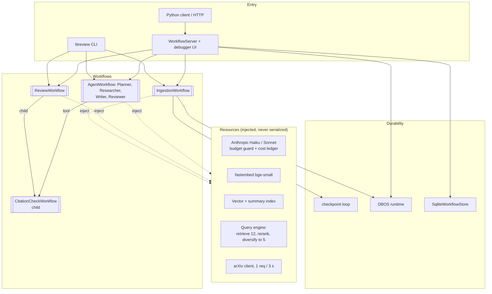
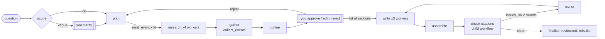

# LitReview (P2): LlamaIndex Workflows

> **You are on the `runs-walkthrough` branch**: `main` plus the artifacts of every run made while
> building P2. Start with [WALKTHROUGH.md](WALKTHROUGH.md). To run the project from scratch, use `main`.

Turns a research question into a **cited mini literature review** over ~25 arXiv papers on
multi-agent LLM orchestration: it plans sub-questions, researches them in parallel over a local index,
asks you to approve the outline, writes the sections, checks every citation against its source chunk,
and outputs `review.md` + `refs.bib`. Built on **LlamaIndex Workflows** (event-driven steps) with
LlamaIndex core for retrieval and Anthropic Claude (Haiku; Sonnet with `--final`).

Project 2 of 7 in an agentic-frameworks lab. Spec: [p2-llamaindex-workflows-literature-review.md](p2-llamaindex-workflows-literature-review.md).
Every version pin, deviation from the spec and bug found on the way: [docs/decisions.md](docs/decisions.md).

**Status:** all milestones (M0-M9) built. 131 tests, $0, no network.

## Quickstart (fresh clone)

```bash
git clone <this repo> && cd p2_llamaindex_literature_review
uv sync                                  # Python 3.12 + pinned deps from uv.lock
cp .env.example .env                     # put your ANTHROPIC_API_KEY in it
uv run pytest                            # 131 tests, ~35 s, $0 (network blocked)
uv run litreview ingest                  # 25 PDFs from data/corpus.lock.json, ~6 min, ~$0.02
uv run litreview review                  # default question; you approve the outline; ~$0.01
```

`ingest` downloads the papers (one arXiv request every 3 s), rebuilds `data/papers.json` from the lock
file, parses, embeds locally (fastembed, 65 MB model on first use) and summarizes with Haiku. It is
checkpointed: kill it and run it again. The review lands in `out/<slug>/review.md`.

## Architecture



How a review runs (no graph is written anywhere: it follows from each step's input and output types):



Generated diagrams of every step and event: [review](docs/review_flow.md), [ingestion](docs/ingest_flow.md),
[agents](docs/agent_flow.md) (`uv run litreview draw`; open the `.html` versions in a browser).
The debugger UI (`uv run litreview serve`) draws the same graphs live: see [docs/debugger.md](docs/debugger.md).

<!-- After the debugger walkthrough, save a screenshot as docs/img/debugger.png and uncomment:

-->

## Results

<!-- RESULTS:START -->

_Generated by `scripts/results.py` from `evals/reports/` and `runs/costs.jsonl`._

### Retrieval (40 labeled questions, paper level)

| config | hit@5 | MRR | papers@5 |
|---|---|---|---|
| sentence-512, rerank on, vector | 0.90 | 0.86 | 1.7 |
| sentence-512, rerank on, vector, <=2 chunks/paper | 0.90 | 0.86 | 2.5 |
| sentence-512, rerank off, vector, <=2 chunks/paper | 0.85 | 0.75 | 2.5 |
| sentence-512, rerank off, vector | 0.82 | 0.74 | 1.9 |

Target (spec): hit@5 >= 0.80.

### Citation faithfulness

_not measured yet: `uv run python -m evals.citations`_

### Review quality

_not measured yet: `uv run python -m evals.quality judge`_

### Explicit workflow vs agents (cost per review, wall time)

| workflow | runs ok | cost / review | LLM calls | wall time | citation score | papers cited |
|---|---|---|---|---|---|---|
| explicit | 6/6 | $0.0095 | 11 | 86s | 96% | 4.3 |
| agentic | 1/6 | $0.1078 | 33 | 186s | 100% | 4.0 |

Details and your notes: [docs/explicit-vs-agentic.md](docs/explicit-vs-agentic.md).

### Total spend

359 LLM calls, **$0.45** of the $10 cap.

<!-- RESULTS:END -->

## Milestone guide

What each milestone added, how to run it, and where each Workflows / LlamaIndex concept lives in the
code. Read top to bottom to follow the build.

### M0: run it yourself

| Command | Cost | What to look at |
|---|---|---|
| `uv run litreview hello Ada` | $0 | The `Progress` events streamed by the loop, then the custom stop event |
| `uv run litreview hello Ada --debug-steps` | $0 | Internal `StepStateChanged` events: each step going `running` → `not_running`, and which event it consumed and produced |
| `uv run litreview hello ""` | $0 | The branch: `start` returns `Greeted` directly and `tick` never runs |
| `uv run litreview tiny` | $0 | The same engine with steps written as plain functions |
| `uv run litreview draw` | $0 | Writes `docs/hello_flow.html` (open it in a browser) and `docs/hello_flow.md` |
| `uv run litreview smoke` | ~$0.0001 | One live Haiku call through the injected LLM Resource |
| `uv run litreview cost` | $0 | Spend so far from `runs/costs.jsonl` |

### How a Workflows run flows

There is no graph definition anywhere. Each `@step` declares the event type it accepts (its
parameter annotation) and what it can emit (its return annotation). At run time:

1. `wf.run(start_event=Greet(...))` puts the start event on the queue.
2. The runtime finds the step whose input type matches **exactly** (`start` takes `Greet`) and runs it.
3. Whatever it returns becomes the next event. `Tick` routes to `tick`; `Greeted` is a `StopEvent`, so the run ends.
4. **Branch:** return a different event type (`start -> Tick | Greeted`).
   **Loop:** a step returns the type it consumes (`tick: Tick -> Tick | Done`).
   **Parallelism:** return a `list[Event]` (from M2 on).
5. Side-channel progress goes to `ctx.write_event_to_stream(...)`; the caller reads `handler.stream_events()`.
6. Shared run data lives in typed state (`Context[HelloState]`), changed atomically under `async with ctx.store.edit_state()`.
7. Heavy objects (LLM clients, indexes) are **Resources**: declared as `Annotated[T, Resource(factory)]` on a
   step parameter and injected by the framework, never stored on events or in state.

`litreview draw` turns those type annotations into the diagram, which is the easiest way to see it.

### Where each M0 concept lives

| Concept | Code |
|---|---|
| Custom StartEvent / StopEvent, branch, loop, streaming, typed state, `edit_state` | [src/litreview/workflows/hello.py](src/litreview/workflows/hello.py) |
| Unbound-function workflow | [src/litreview/workflows/tiny_unbound.py](src/litreview/workflows/tiny_unbound.py) |
| Resource injection into a step | [src/litreview/workflows/smoke.py](src/litreview/workflows/smoke.py) |
| Chained Resource + `ResourceConfig` (JSON → Pydantic) | `get_llm` in [src/litreview/resources.py](src/litreview/resources.py) |
| Cost ledger (instrumentation handler) and budget guard | [src/litreview/cost.py](src/litreview/cost.py) |
| Caller side: `stream_events(expose_internal=...)` | `_run_streaming` in [src/litreview/cli.py](src/litreview/cli.py) |
| `WorkflowTestRunner`, overriding Resources with fakes | [tests/](tests/), `override_resources` in [tests/conftest.py](tests/conftest.py) |
| Drawing | `draw` in [src/litreview/cli.py](src/litreview/cli.py), output in [docs/](docs/) |

### M1: build the corpus

```bash
uv run python scripts/fetch_corpus.py                 # search, pick ~25 from the list, download
uv run python scripts/fetch_corpus.py                 # again: expect "network requests: 0"
uv run python scripts/fetch_corpus.py --repick        # change your pick (search is cached: 0 requests)
```

What happens, in order:

1. **Search** (`config/topic.json` query, 40 hits) plus the ★ suggestions, one request each.
   Both are cached in `data/cache/arxiv/`, so later runs never search again.
2. **You pick** with ranges like `1-20,23,41-44`.
3. **Lock**: `data/corpus.lock.json` records each paper's id, version and (after download) sha256.
   Commit it: it is the reproducible definition of the corpus. `data/papers.json` (metadata for
   BibTeX) is git-ignored and rebuilt from the lock with one request on a fresh clone.
4. **Download** `https://arxiv.org/pdf/<id>v<version>` into `data/pdfs/`, one request every 3 s.
   A file whose hash matches the lock is kept, a damaged one is fetched again, an HTML
   "PDF being generated" page is rejected. Ctrl-C is safe: files are written to a temp name and renamed.

| Piece | Where |
|---|---|
| Rate limiter shared by every request | `RateLimiter` in [corpus.py](src/litreview/corpus.py) |
| Disk cache, idempotent hashed download | `ArxivClient` in [corpus.py](src/litreview/corpus.py) |
| Lock + metadata files | `CorpusLock`, `PaperMeta` in [corpus.py](src/litreview/corpus.py) |
| Resource that M2 will inject | `get_arxiv_client` in [resources.py](src/litreview/resources.py) |
| Interactive pick | [scripts/fetch_corpus.py](scripts/fetch_corpus.py) |

### M2: ingestion workflow

```bash
uv run litreview ingest --limit 2         # try 2 papers first (~1 min, ~$0.002)
uv run litreview ingest                   # all 25: ~5 min (CPU embedding), ~$0.02 of Haiku
uv run litreview ingest                   # again: ~5 s, 0 new chunks, $0
uv run litreview ingest --fail 2308.00352 # watch retries, then catch_error recovery (~30 s of backoff)
uv run litreview ingest --debug-steps     # see every step start/finish and its worker id
uv run litreview draw                     # docs/ingest_flow.md (+ .html): the graph from the types
uv run python scripts/splitter_experiment.py --only sentence-1024   # optional, $0, feeds M3
```

The first run downloads the embedding model (65 MB) into `.cache/fastembed`.

How events flow (no graph is written anywhere; it comes from the step signatures):

```
IngestRequest ─load_lock─▶ list[PaperToFetch]       fan-out: one branch per paper
  PaperToFetch ─fetch_pdf (2 workers, retried)─▶ PaperFetched        ─┐ failure after 4 attempts:
  PaperFetched ─parse_pdf (4 workers)─▶ PaperParsed                   │ on_fetch_failure records it,
  PaperParsed ─index_paper (1 worker)─▶ PaperIndexed                  │ the branch ends
  PaperIndexed ─summarize_paper (3 workers, retried)─▶ PaperSummarized
list[PaperSummarized] ─persist─▶ IngestReport       fan-in: fires once every branch has finished
```

| Concept | Where |
|---|---|
| Fan-out by returning a list | `load_lock` in [ingestion.py](src/litreview/workflows/ingestion.py) |
| List fan-in (stream join, no counting) | `persist` |
| `num_workers` and why each value | decorator comments on each step |
| Composable `retry_policy`, `ctx.retry_info()` | [retry.py](src/litreview/retry.py), `fetch_pdf` |
| Custom `RetryPolicy` (`Scaled`) | [retry.py](src/litreview/retry.py) |
| `@catch_error(for_steps=...)` returning `None` | `on_fetch_failure` |
| Typed state + `edit_state` under parallel workers | [state.py](src/litreview/state.py), every step |
| Resources: cached, chained, `ResourceConfig` with `path_selector` | `get_storage` in [resources.py](src/litreview/resources.py) |
| IngestionPipeline (docstore dedupe, cache) -> VectorStoreIndex | [pipeline.py](src/litreview/retrieval/pipeline.py) |
| PDF clean-up and section tagging | [parsing.py](src/litreview/retrieval/parsing.py) |
| Capped summary input (abstract + intro + conclusion) | [summaries.py](src/litreview/retrieval/summaries.py) |
| Execution drawing of the last run | `runs/ingest_execution.mermaid` |

On disk: `data/parsed/<id>.jsonl` (segments), `data/storage/` (index), `data/summaries/<id>.json`,
`data/cache/ingestion/` (embedding cache, survives `--rebuild`).

### M3: retrieval layer and the labeled question set

```bash
uv run litreview ingest                                  # once: builds the summary index ($0, ~10 s)
uv run python scripts/splitter_experiment.py --only sentence-1024   # optional ($0, ~4 min; semantic ~20 min)
uv run python scripts/bootstrap_qa.py                    # Haiku drafts ~40 questions (~$0.003)
uv run python scripts/curate_qa.py                       # YOU keep/edit/drop until 25 are kept
uv run python -m evals.retrieval --apply                 # eval matrix (~$0.01), writes the winner to config
uv run python scripts/compare_subquestion.py             # SubQuestionQueryEngine on 3 questions (~$0.01)
```

If `--apply` changes the splitter, re-index with `uv run litreview ingest --rebuild` (no re-embedding of
unchanged chunks, no new summaries).

How a question is answered with retrieval:

```
question ─▶ router (Haiku picks one) ─┬─▶ vector retriever:  top-12 chunks by embedding
                                      └─▶ summary retriever: all chunks of the 2 best-matching papers
         ─▶ reranker (cross-encoder, local) ─▶ top-5 chunks   ← what M4's research step gets
```

| Piece | Where |
|---|---|
| Reranker (`BaseNodePostprocessor` on fastembed ONNX) | `FastEmbedRerank` in [engines.py](src/litreview/retrieval/engines.py) |
| DocumentSummaryIndex reusing saved summaries | `StoredSummarySynthesizer`, `ensure_summary_index` |
| Router (`RouterRetriever` + `LLMSingleSelector`) | `make_retriever` |
| Retriever + reranker as one engine (`RetrieverQueryEngine.retrieve`) | `make_query_engine` |
| The Resource M4 injects | `get_query_engine` in [resources.py](src/litreview/resources.py) |
| Question drafting (structured LLM output) and curation | [qa.py](src/litreview/qa.py), [scripts/](scripts/) |
| Eval matrix, hit-rate@5 and MRR | [evals/retrieval.py](evals/retrieval.py) -> `evals/reports/retrieval.md` |

### M4: the review workflow

```bash
uv run litreview review                               # default question from config/topic.json (~$0.01)
uv run litreview review "How do agents share memory?" --max-subquestions 3
uv run litreview review --debug-steps                 # watch research run 4 at a time
uv run litreview review --final                       # sections written by Sonnet (~$0.10)
uv run litreview review --json | head                 # every streamed event as NDJSON
```

Output in `out/<slug>/`: `review.md`, `refs.bib`, `citations.json` (each [n] -> claims -> chunk ids and
quotes), `log.txt` (every Progress event), `execution.md` (what actually ran, as Mermaid).
In M4 the outline is approved automatically (and a vague question clarified with the first suggestion);
M5 asks you.

```
ReviewRequest ─scope─▶ QuestionScoped | NeedsClarification ··you··▶ Clarified       branch + HITL
   ─plan─▶ SubQuestion ×N (ctx.send_event)                                           fan-out
   ─research ×4 workers─▶ Finding ×N   (failure: on_research_failed -> Finding(error))
   ─gather_findings (ctx.collect_events)─▶ FindingsReady                             fan-in
   ─draft_outline─▶ OutlineApprovalRequired ··you··▶ OutlineDecision                 HITL
   ─on_outline_decision─▶ list[WriteSection]  (reject: ReplanRequested -> plan)      fan-out / loop
   ─write_section ×3 workers (tokens streamed)─▶ SectionDraft
   ─assemble (list[SectionDraft])─▶ DraftAssembled ─finalize─▶ ReviewReady           fan-in
```

| Concept | Where (all in [review.py](src/litreview/workflows/review.py) unless noted) |
|---|---|
| Branch by union return; custom StartEvent / StopEvent | `scope`, `ReviewRequest`, `ReviewReady` |
| `ctx.send_event` fan-out, declared in the return annotation | `plan` |
| `ctx.collect_events` fan-in (vs list fan-in in `assemble`) | `gather_findings` |
| `num_workers`, Resources shared by parallel workers | `research`, `write_section` |
| Scoped and wildcard `@catch_error` | `on_research_failed`, `on_any_failure` |
| Custom `RetryAfterPolicy`, structured-output re-prompt | [retry.py](src/litreview/retry.py) |
| HITL events + the caller that answers them | `draft_outline`, [hitl.py](src/litreview/hitl.py) |
| Loop bounded by a state counter | `on_outline_decision` -> `plan` |
| `accept_event_subclasses` | `log_progress` |
| Token streaming (`SectionToken`) and the live view | `write_section`, [review_view.py](src/litreview/review_view.py) |
| Typed state with `edit_state` | [state.py](src/litreview/state.py) `ReviewState` |
| Deterministic citations and BibTeX | [bib.py](src/litreview/bib.py) |

### M5: human in the loop, citation checking, crash-safe ingestion

One-time migration (chunk ids became deterministic; ~5 min of local embedding, $0):

```bash
rm -rf data/cache/ingestion && uv run litreview ingest --rebuild
```

```bash
uv run litreview review                        # you approve the outline: [a]pprove [e]dit [r]eject
uv run litreview review --yes                  # M4 behaviour: approve automatically
uv run litreview review --detach               # stop at the outline, save the run, exit
uv run litreview pending                       # what is waiting
uv run litreview approve <run_id>              # restore in this process and approve
uv run litreview approve <run_id> --edit       # ...or edit the outline in $EDITOR first
uv run litreview approve <run_id> --reject "more on failure handling"   # re-plans; detaches again
uv run python scripts/crash_ingest.py          # kill -9 an ingest at 12 summaries, restart, check (~$0.02)
```

| Concept | Where |
|---|---|
| HITL pattern A: InputRequired -> caller -> HumanResponse | `interactive_responder` in [hitl.py](src/litreview/hitl.py) |
| HITL pattern B: `ctx.to_dict()` -> `cancel_run()` -> `Context.from_dict()` -> `run(ctx=)` -> `send_event` | `drive` (DETACH), `PendingStore`, `resume_pending` |
| Child workflow with shared Resources | [citation_check.py](src/litreview/workflows/citation_check.py), `check_citations` |
| Bounded loop (check -> revise -> write) | `check_citations`, `revise` in [review.py](src/litreview/workflows/review.py) |
| Checkpoint loop on `StepStateChanged` | [durability.py](src/litreview/durability.py), `litreview ingest` |
| At-least-once resume made safe: deterministic ids, persist-then-done, atomic files | [pipeline.py](src/litreview/retrieval/pipeline.py), `index_paper` |
| Crash test (real kill -9) | [scripts/crash_ingest.py](scripts/crash_ingest.py) |

### M6: the same review as agents, and the comparison

```bash
uv run litreview agent-review                       # Planner -> Researcher -> Writer -> Reviewer, you approve the outline
uv run litreview agent-review --yes                 # outline approved automatically
uv run litreview agent-review --detach              # pause at the outline; then `litreview approve <run_id>`
uv run litreview agent-review "follow-up question" --session mytopic   # reuse the conversation of an earlier run
uv run python scripts/compare_workflows.py --questions 1 --repeats 1   # quick look (~$0.1)
uv run python scripts/compare_workflows.py          # full protocol: 3 questions x 2 repeats (~$0.5-1)
```

Output goes to `out/<slug>/agent/` (next to Workflow 2's `out/<slug>/`). The comparison writes
`docs/explicit-vs-agentic.md`; fill in the "Your notes" section.

| Concept | Where |
|---|---|
| `AgentWorkflow` + four `FunctionAgent`s, `can_handoff_to` | `build_agent_review` in [agent_review.py](src/litreview/workflows/agent_review.py) |
| Tools that take `ctx: Context` first; shared state in `ctx.store` | `ReviewTools` |
| HITL pattern C: `ctx.wait_for_event(..., waiter_id=...)` inside a tool | `propose_outline` |
| Agent memory (SQLite session), re-attached after restore | `agent_memory`, `attach_memory` |
| Streaming `AgentInput` / `ToolCall` / `ToolCallResult` | `_AgentUI` in [cli.py](src/litreview/cli.py) |
| Same renderer for both workflows | [render.py](src/litreview/render.py) |
| Comparison protocol (§8.3) | [scripts/compare_workflows.py](scripts/compare_workflows.py) |
| Agents, tools and handoffs as a diagram | [docs/agent_flow.md](docs/agent_flow.md) |

### M7: serving over HTTP, and durability the runtime owns

```bash
uv run litreview serve                       # http://127.0.0.1:8080/ : debugger UI + HTTP API
uv run python scripts/client_demo.py         # in another terminal: a review driven over HTTP (~$0.01)
uv run litreview serve --runtime dbos        # same, on the DBOS runtime (review + ingest)
uv run litreview ingest --runtime dbos       # ingestion without the checkpoint loop
uv run python scripts/crash_ingest.py --runtime dbos   # kill -9 test on DBOS (~$0.02)
uv run python scripts/server_restart_demo.py # store vs DBOS when the server dies ($0, ~2.5 min)
```

In the debugger UI: pick `review`, start it with a question, watch the events, and when
`OutlineApprovalRequired` appears use **Send Event** with an `OutlineDecision` (`{"action": "approve"}`).
Over plain HTTP that is `POST /events/{handler_id}` with `{"event": {...}}`.

| Concept | Where |
|---|---|
| `WorkflowServer`, `SqliteWorkflowStore`, `additional_events`, `idle_timeout` | [server.py](src/litreview/server.py) |
| Python client: run-nowait, stream, send_event, get_handler | [scripts/client_demo.py](scripts/client_demo.py), [tests/test_server.py](tests/test_server.py) |
| DBOS runtime for direct runs (run id = the only state you keep) | `dbos_runtime`, `run_durable` in [durability.py](src/litreview/durability.py) |
| DBOS runtime for the server | `production_server("dbos")` |
| Retry policies that survive pickling | `NamedPolicy` in [retry.py](src/litreview/retry.py) |
| Restart behaviour, measured | [scripts/server_restart_demo.py](scripts/server_restart_demo.py), docs/decisions.md D12 |

### M8: tracing, the debugger UI, and the evals

```bash
uv run python scripts/trace_summary.py                  # latest traced run as a tree (every run is traced)
uvx --from arize-phoenix phoenix serve                  # optional UI; then OTEL_EXPORTER=otlp in .env
uv run litreview cost --by-step                         # where the money goes
uv run python -m evals.retrieval --no-router --apply    # re-measure retrieval incl. the diversity cap ($0)
uv run python -m evals.citations                        # 3 fresh reviews + citation faithfulness (~$0.05)
uv run python -m evals.quality judge                    # Sonnet rubric on those 3 reviews (~$0.05)
uv run python -m evals.quality sheet                    # then fill evals/reports/quality_blind/scores.json
uv run python -m evals.quality agree
uv run python -m evals.compare --save                   # baseline; later: uv run python -m evals.compare
```

Walkthroughs to fill in with your screenshots: [docs/observability.md](docs/observability.md),
[docs/debugger.md](docs/debugger.md).

| Concept | Where |
|---|---|
| OTel export (file + OTLP), custom `CitationChecked` event | [telemetry.py](src/litreview/telemetry.py) |
| Custom span with `@dispatcher.span` | [quotes.py](src/litreview/quotes.py) |
| Span tree and step concurrency from the trace file | [traces.py](src/litreview/traces.py), [scripts/trace_summary.py](scripts/trace_summary.py) |
| Diversity cap after reranking | `Diversify` in [engines.py](src/litreview/retrieval/engines.py) |
| Citation, quality and regression evals | [evals/](evals/) |
