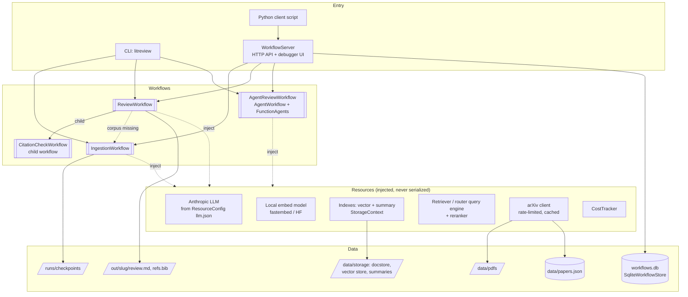
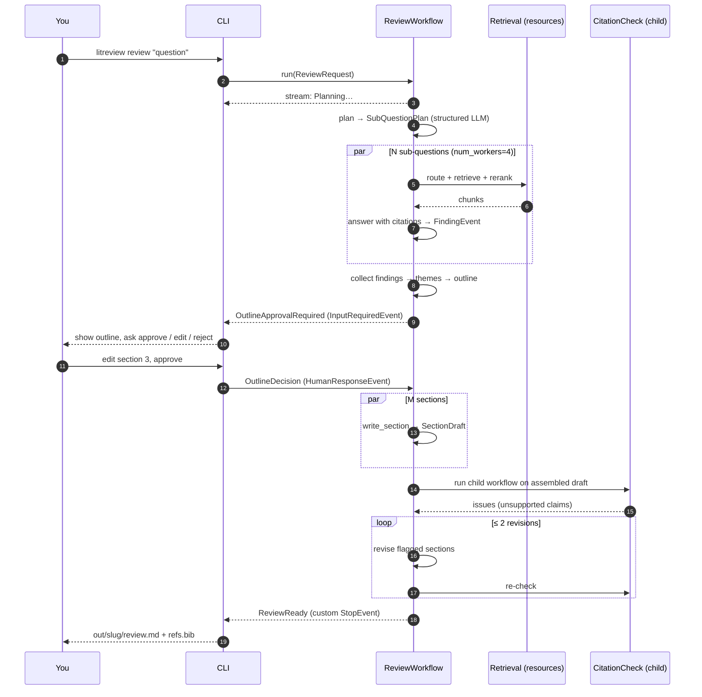
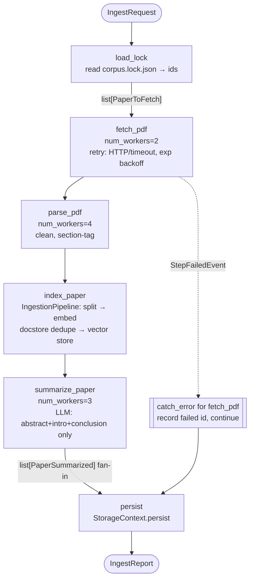
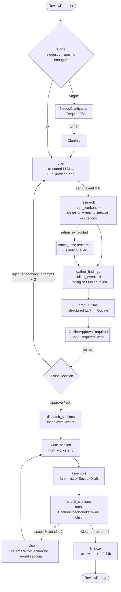

# P2 — LlamaIndex Workflows: LitReview Agent

> **Detailed build spec, Project 2 of 7** in the agentic frameworks lab (see `agentic-frameworks-build-plan.md`).
> **Framework:** standalone **LlamaIndex Workflows** (`llama-index-workflows`, imported as `workflows`), plus:
> - `llama-agents-server`: WorkflowServer and the debugger UI
> - `llama-agents-dbos`: durable runtime
> - `llama-index-core`: indexes, retrieval, `AgentWorkflow`
> - `llama-index-utils-workflow`: drawing
>
> **Model provider:** Anthropic Claude via `llama-index-llms-anthropic`; **local embeddings** (Anthropic has no embeddings API)
> **Budget cap:** **$10** (enforced in code)
> **Estimated effort:** 1.5 weeks part-time
>
> This file supersedes Section 3 of the master plan.

---

## Table of contents
0. [Rules for Claude Code](#0-rules-for-claude-code)
1. [What you're building and why](#1-what-youre-building-and-why)
2. [Workflows primer: concepts this project must cover](#2-workflows-primer)
3. [System architecture](#3-system-architecture)
4. [Corpus: arXiv papers](#4-corpus-arxiv-papers)
5. [Events, state and resources](#5-events-state-and-resources)
6. [Workflow 1: Ingestion](#6-workflow-1-ingestion)
7. [Workflow 2: Literature Review (main)](#7-workflow-2-literature-review-main)
8. [Workflow 3: AgentWorkflow variant](#8-workflow-3-agentworkflow-variant)
9. [Retrieval layer (LlamaIndex core)](#9-retrieval-layer-llamaindex-core)
10. [Human-in-the-loop](#10-human-in-the-loop)
11. [Errors, retries and recovery](#11-errors-retries-and-recovery)
12. [Durability](#12-durability)
13. [Serving: WorkflowServer, debugger UI, client](#13-serving-workflowserver-debugger-ui-client)
14. [Streaming and the CLI experience](#14-streaming-and-the-cli-experience)
15. [Observability](#15-observability)
16. [Testing strategy ($0 tests)](#16-testing-strategy-0-tests)
17. [Evals](#17-evals)
18. [Repository layout](#18-repository-layout)
19. [Configuration](#19-configuration)
20. [Milestones](#20-milestones)
21. [Budget plan](#21-budget-plan)
22. [Stretch goals](#22-stretch-goals)
23. [Learning journal](#23-learning-journal)
24. [Feature coverage matrix](#24-feature-coverage-matrix)
25. [Kickoff prompts](#25-kickoff-prompts)
26. [References](#26-references)

---

## 0. Rules for Claude Code

These rules are in addition to Section 0 of the master plan. The developer is learning, so they stay in control.

1. **One milestone at a time** (Section 20). At the end of each milestone, stop and give:
   - what was built
   - how to run it
   - which Workflows/LlamaIndex concepts it used, and where in the code
   - the spend so far

   Then wait for the go-ahead.
2. **Verify before you write.** Code in this spec is *illustrative*. The Workflows docs now live under "LlamaAgents → Agent Workflows" at developers.llamaindex.ai. **Install the LlamaIndex docs MCP server in Claude Code** (`https://developers.llamaindex.ai/mcp`), and use it, or the installed package source, to confirm every API before using it. Any docs page is also available as raw Markdown by appending `index.md` to its URL.
3. **Use the standalone imports.** Write `from workflows import Workflow, Context, step` and `from workflows.events import ...`. Do **not** use the legacy `llama_index.core.workflow` re-exports, except where an `llama_index.core` agent API requires them. Flag any place where you had to mix the two.
4. **Use the native feature.** Don't hand-roll fan-out, fan-in, retries, state locking, dependency injection, HITL plumbing, checkpointing or drawing. Workflows provides all of them. If hand-rolling seems justified, ask first.
5. **Explain every primitive.** When you introduce an event type, a step option (`num_workers`, `retry_policy`, `accept_event_subclasses`), a Resource, `@catch_error`, a waiter or a runtime plugin, add a one-line comment explaining *why it was chosen here*.
6. **$0 tests.** Use `MockLLM` / `MockEmbedding` (or the current equivalents) and `WorkflowTestRunner`. Live calls happen only in `scripts/` and `evals/`, and only when the developer runs them.
7. **Events and state must be JSON-serializable.** No bytes, clients or indexes on events or in `ctx.store`. Those go in Resources. This is what makes snapshots and durability work.
8. **Always set `max_tokens`** on the Anthropic LLM, and cap how much text is sent per call (§21).
9. Respect arXiv's API terms: at most 1 request every 3 seconds, cache everything, and never re-download.
10. Don't add dependencies outside §19.2 without asking.

---

## 1. What you're building and why

### 1.1 The product
**LitReview** turns a research question into a **cited mini literature review** over a local corpus of ~25 arXiv papers. It does five things:

1. **Ingests** papers (search arXiv → download → parse → chunk → embed → per-paper summaries), resumably.
2. **Plans** the review: it breaks the question into 4–6 sub-questions.
3. **Researches** the sub-questions in parallel over a hybrid of vector and summary retrieval. Every finding is tied to specific chunks.
4. **Pauses for you**: you approve, edit or reject the proposed outline before any writing happens.
5. **Writes** each section in parallel, then runs a citation-checking loop until every claim cites a real chunk. It outputs `review.md` plus a BibTeX bibliography.

The same workflows are served over HTTP with a visual **debugger UI**, where you can watch events flow and answer the outline approval from the browser.

### 1.2 Default topic
**"Orchestration patterns for LLM-based multi-agent systems."** This topic is meta on purpose: the review you generate becomes study material for the rest of this lab. You can change it in config.

### 1.3 Why this project for LlamaIndex Workflows

| Need in the domain | Workflows / LlamaIndex feature |
|---|---|
| Many independent papers to process | Fan-out by returning `list[Event]`, `num_workers`, list fan-in |
| Long ingestion must survive crashes | Context snapshots, checkpoint loop, DBOS runtime |
| Sub-questions research in parallel, then merge | `send_event` / `collect_events` (and list fan-in), typed state with `edit_state()` |
| Human must approve the outline | `InputRequiredEvent` / `HumanResponseEvent`, snapshot + `cancel_run` + restore |
| Writer ↔ checker iteration | Loops via event types, bounded by state counters |
| Flaky network and rate limits | Composable `retry_policy`, `@catch_error` recovery |
| Heavy objects (LLM, indexes, clients) | `Resource` / `ResourceConfig` injection |
| Retrieval over documents | LlamaIndex core: `IngestionPipeline`, `VectorStoreIndex`, `DocumentSummaryIndex`, router, reranker |
| Compare with agentic orchestration | `AgentWorkflow` + `FunctionAgent` handoffs |
| Run it as a service | `WorkflowServer` + `SqliteWorkflowStore` + debugger UI + Python client |

### 1.4 Non-goals
- No LlamaCloud / LlamaParse paid services. Parsing is local. (LiteParse, the open-source local parser, is a stretch comparison.)
- No vector DB server. Use the on-disk default storage (Chroma or LanceDB are a stretch).
- No frontend beyond the built-in debugger UI (llamactl UI is a stretch).

### 1.5 What "done" looks like
- `uv run litreview ingest` builds the corpus, and is resumable after `kill -9`.
- `uv run litreview review "…question…"` streams progress, pauses for outline approval, and writes `out/<slug>/review.md` and `refs.bib`.
- **≥ 95%** of the review's citations resolve to a real chunk that supports the claim (citation eval, §17).
- Retrieval hit-rate@5 is **≥ 0.8** on the labeled question set.
- `python -m llama_agents.server src/litreview/server.py` serves all workflows; the outline approval works from the debugger UI.
- `pytest` runs in < 40 s with 0 network and 0 model calls.
- Total spend is ≤ $10.

---

## 2. Workflows primer

Claude Code should explain each of these concepts to the developer as it first uses it.

| Concept | One-liner | Where used |
|---|---|---|
| **Event** | A Pydantic model that carries data between steps. Routing is by **exact type** (unless `accept_event_subclasses=True`). | Everywhere (§5) |
| **Step** | An async method decorated with `@step`. Its input event type annotation decides what triggers it; its return annotation declares what it can emit. The workflow is validated from these annotations. | Everywhere |
| **StartEvent / StopEvent** | Entry and exit points; can be **custom subclasses** with typed fields | `ReviewRequest`, `ReviewReady` |
| **Context** | Per-run runtime: the event queue, the state store, streaming, waiters. Serializable with `to_dict()` / `from_dict()`. | All workflows |
| **State store** | `ctx.store.get/set`; **typed** via `Context[MyState]`; atomic updates with `async with ctx.store.edit_state()` | `ReviewState`, `IngestState` |
| **Fan-out** | Return `list[Event]` from a step, or call `ctx.send_event()` several times | Downloads, sub-questions, sections |
| **Fan-in** | A step that takes `list[DoneEvent]`, or `ctx.collect_events(ev, [Type]*n)` | Collect findings and sections |
| **`num_workers`** | Concurrency limit per step | Research, write, download |
| **Branches / loops** | Return different event types; return an earlier event type to loop | Outline reject → replan; writer ↔ checker |
| **Streaming** | `ctx.write_event_to_stream(ev)`; the caller uses `handler.stream_events()`. `expose_internal=True` adds `StepStateChanged`. | Progress UI, checkpointing |
| **Resources** | `Annotated[T, Resource(factory)]` injected into steps; cached per run; **never serialized**. `ResourceConfig` loads JSON config into a Pydantic model; resources can chain. | LLM, embeddings, index, arXiv client |
| **HITL** | `InputRequiredEvent` → caller → `HumanResponseEvent`; or `ctx.wait_for_event(...)` with `waiter_id` / `requirements` | Outline approval |
| **Retry policy** | `@step(retry_policy=retry_policy(retry=..., wait=..., stop=...))`, composable with `\|`, `&`, `+`; `ctx.retry_info()` | Downloads, LLM calls |
| **`@catch_error`** | Recovery step for `StepFailedEvent` once retries are exhausted; `for_steps=[...]`, `max_recoveries` | Research fallback |
| **Durability** | Snapshot the Context (checkpoint loop on `StepStateChanged`), or the **DBOS runtime plugin** | Ingestion |
| **Nested workflows** | A step can run another workflow (child) | Review → ingestion if the corpus is missing |
| **Unbound-function workflows** | Build a workflow from plain functions (check the docs) | Tiny utility workflow, for comparison |
| **Drawing** | `draw_all_possible_flows(_mermaid)`, `draw_most_recent_execution(_mermaid)` | `docs/` diagrams |
| **WorkflowServer** | HTTP API + debugger UI + `SqliteWorkflowStore`; send events to running handlers | §13 |
| **Testing** | `workflows.testing.WorkflowTestRunner` → `result`, `collected`, `event_types`, `ctx` | §16 |
| **AgentWorkflow** | Multi-agent (`FunctionAgent`s with handoffs) built *on top of* Workflows | §8 |

### 2.1 Mental model to internalize
> **LangGraph (P4) = an explicit graph of nodes and edges. Workflows = events plus listeners.** No graph is ever written down; the graph *emerges* from the type annotations. Branching is "return a different event", and parallelism is "emit several events". Keep this contrast in mind for the journal.

### 2.2 Gotchas to watch for
- Event routing is **exact-type** by default; subclass routing is opt-in per step.
- A resumed run is **at-least-once**: a step that was mid-flight at snapshot time re-runs from the top. Step side effects must be idempotent.
- `wait_for_event` **replays the code before it** each time the step is re-triggered, so code above the waiter must be safe to repeat. The docs recommend the separate-steps HITL pattern instead.
- Workflow instance attributes are **not** in snapshots. Durable data goes on events or in the state store.
- `to_dict()` fails as a whole if *any* field is unserializable.
- The server's `/events/{handler_id}` stream allows **one reader**, and streamed events can't be replayed.
- Events received via `wait_for_event` must be registered with `server.add_workflow(..., additional_events=[...])` for the debugger UI's "Send Event" to know about them.

---

## 3. System architecture

### 3.1 Component view



### 3.2 End-to-end sequence



---

## 4. Corpus: arXiv papers

### 4.1 Acquisition
- `scripts/fetch_corpus.py` (also wrapped by the ingestion workflow's `search` step) queries the **arXiv API** with the configured topic query. It takes the top 40 hits by relevance, then **you** pick about 25 via an interactive checklist: a HITL moment outside Workflows, kept simple.
- A pinned list in `data/corpus.lock.json` (arXiv IDs plus versions) makes runs reproducible. Once it exists, ingestion uses the lock and never searches again.
- Download PDFs into `data/pdfs/<arxiv_id>.pdf`, with a ≥ 3 s gap between requests. Skip files that already exist.
- Store metadata (title, authors, year, abstract, categories, primary URL) in `data/papers.json`. This is the source for BibTeX.

### 4.2 Parsing
- Default: `PyMuPDFReader` (or `llama-index-readers-file`), page-level documents with metadata `{arxiv_id, title, page}`.
- Clean-up: strip references sections (the heuristic is to stop at a heading matching `^References$|^Bibliography$`), de-hyphenate, and drop page headers and footers.
- **Exercise (M2):** compare against a section-aware split (abstract / intro / method / results / conclusion detected by headings), and keep the `section` metadata for better citations.
- Stretch: compare with **LiteParse**, the open-source local parser.

### 4.3 Hand-labeled question set (for retrieval evals)
`data/qa/labeled.jsonl` has 25 questions. Each one has: `question`, `relevant_arxiv_ids` (1–3), and optionally `relevant_section`.
- Bootstrapping: generate 40 candidates with Haiku from the abstracts (~$0.10), then **you** curate them down to 25. This is the only LLM-generated eval data, and a human checks it.

---

## 5. Events, state and resources

`src/litreview/events.py`, `state.py`, `resources.py`. Illustrative; verify against the installed version.

### 5.1 Events

```python
from workflows.events import Event, StartEvent, StopEvent, InputRequiredEvent, HumanResponseEvent

# ---------- ingestion ----------
class IngestRequest(StartEvent):
    lock_file: str = "data/corpus.lock.json"
    rebuild: bool = False

class PaperToFetch(Event):      arxiv_id: str
class PaperFetched(Event):      arxiv_id: str; pdf_path: str
class PaperParsed(Event):       arxiv_id: str; n_pages: int; n_chars: int
class PaperIndexed(Event):      arxiv_id: str; n_nodes: int
class PaperSummarized(Event):   arxiv_id: str; summary_chars: int
class IngestProgress(Event):    stage: str; done: int; total: int; arxiv_id: str | None = None

class IngestReport(StopEvent):
    papers: int; nodes: int; skipped: int; failed: list[str]

# ---------- review ----------
class ReviewRequest(StartEvent):
    question: str
    max_subquestions: int = 5
    target_words: int = 1500
    audience: str = "ML engineers"

class NeedsClarification(InputRequiredEvent):   # branch: the question is too vague
    question: str; suggestions: list[str]

class Clarified(HumanResponseEvent):
    refined_question: str

class SubQuestion(Event):       idx: int; text: str; rationale: str
class Finding(Event):           idx: int; sub_question: str; answer: str; citations: list["Citation"]
class FindingFailed(Event):     idx: int; sub_question: str; error: str
class OutlineApprovalRequired(InputRequiredEvent):
    outline: "Outline"; attempt: int
class OutlineDecision(HumanResponseEvent):
    action: str                     # "approve" | "edit" | "reject"
    edited_outline: "Outline | None" = None
    feedback: str | None = None
class WriteSection(Event):      section_idx: int; heading: str; points: list[str]; finding_ids: list[int]
class SectionDraft(Event):      section_idx: int; markdown: str; citations: list["Citation"]
class DraftAssembled(Event):    markdown: str
class CitationIssues(Event):    issues: list["CitationIssue"]; round: int
class Progress(Event):          stage: str; message: str; pct: float | None = None

class ReviewReady(StopEvent):
    markdown_path: str; bib_path: str; n_citations: int; unsupported_claims: int; cost_usd: float
```

### 5.2 Domain models (Pydantic, used inside events and as structured LLM outputs)

```python
class Citation(BaseModel):
    arxiv_id: str
    node_id: str               # the exact chunk the claim relies on
    page: int | None = None
    quote: str = Field(max_length=300, description="short supporting span from the chunk")

class SubQuestionPlan(BaseModel):
    sub_questions: list[SubQuestion]  # 3–6
    scope_note: str

class OutlineSection(BaseModel):
    heading: str
    points: list[str]
    finding_ids: list[int]

class Outline(BaseModel):
    title: str
    sections: list[OutlineSection]   # 4–7, including intro and conclusion

class CitationIssue(BaseModel):
    section_idx: int
    claim: str
    problem: Literal["no_citation", "citation_not_supporting", "unknown_node"]
    suggested_fix: str | None = None
```

### 5.3 Typed state

```python
class ReviewState(BaseModel):
    question: str = ""
    sub_questions: list[str] = []
    expected_findings: int = 0
    findings: dict[int, Finding] = {}           # by idx
    failed: list[int] = []
    outline: Outline | None = None
    outline_attempts: int = 0
    sections: dict[int, SectionDraft] = {}
    expected_sections: int = 0
    citation_rounds: int = 0
    cost_usd: float = 0.0

class IngestState(BaseModel):
    total: int = 0
    fetched: list[str] = []
    indexed: list[str] = []
    summarized: list[str] = []
    failed: list[str] = []
```

All fields have defaults, as the docs require for automatic state initialization. Steps use `Context[ReviewState]`, and use `async with ctx.store.edit_state() as s:` for read-modify-write. **Never call an LLM inside the lock.**

### 5.4 Resources

| Resource | Factory | Notes |
|---|---|---|
| `LLMConfig` | `ResourceConfig(config_file="config/llm.json", path_selector="dev")` | `{model, temperature, max_tokens}`; a `final` section for Sonnet |
| `llm` | `get_llm(config: Annotated[LLMConfig, ResourceConfig(...)])` → `Anthropic(...)` | **Chained resource** (the docs pattern) |
| `embed_model` | `get_embed_model()` → fastembed `BAAI/bge-small-en-v1.5` (or the HF equivalent) | Local, free |
| `storage` | `get_storage()` → `StorageContext` loaded from `data/storage` | Cached per run |
| `vector_index`, `summary_index` | Chained on `storage` + `embed_model` | |
| `query_engine` | `get_router()` → `RouterQueryEngine` (vector vs summary) + `SentenceTransformerRerank` | §9 |
| `arxiv` | `get_arxiv_client()` → rate-limited, on-disk-cached client | 3 s spacing |
| `cost` | `get_cost_tracker()` → wraps `shared/cost.py`; hooked into the LLM callback / instrumentation | Budget guard |
| `fresh_scratch` | `Resource(make_scratch, cache=False)` | Shows `cache=False` semantics (tiny demo) |

---

## 6. Workflow 1: Ingestion

### 6.1 Flow



### 6.2 Step contracts

| Step | In → Out | Options | Notes |
|---|---|---|---|
| `load_lock` | `IngestRequest` → `list[PaperToFetch]` | | Fan-out by returning a list; sets `IngestState.total` |
| `fetch_pdf` | `PaperToFetch` → `PaperFetched` | `num_workers=2`, `retry_policy(retry=retry_if_exception_type((TimeoutError, ConnectionError)) \| retry_if_exception_message(match="429\|rate"), wait=wait_exponential_jitter(initial=3, max=60), stop=stop_after_attempt(4))` | **Idempotent**: skip if the file exists and its hash matches. Uses `ctx.retry_info()` to log retries. |
| `parse_pdf` | `PaperFetched` → `PaperParsed` | `num_workers=4` | Writes parsed docs to `data/parsed/<id>.jsonl` (events carry IDs, not text) |
| `index_paper` | `PaperParsed` → `PaperIndexed` | `num_workers=2` | `IngestionPipeline` with a **docstore** and **cache** gives dedupe and upsert, so re-runs are no-ops |
| `summarize_paper` | `PaperIndexed` → `PaperSummarized` | `num_workers=3`, LLM retry policy | Only send the abstract + intro + conclusion (≤ 6k tokens) |
| `persist` | `list[PaperSummarized]` → `IngestReport` | | **List fan-in**: fires once all expected events have arrived (check how the expected count is determined, or use `collect_events` with the state's total) |
| `on_fetch_failure` | `StepFailedEvent` → `PaperSummarized`-like sentinel or `IngestProgress` | `@catch_error(for_steps=["fetch_pdf"])` | Lets the run complete with a partial corpus. Lesson: recovery that re-routes. |

> Claude Code: decide between list fan-in and `collect_events` for `persist` when one paper fails. The fan-in count must still be met. Explain the choice (a sentinel event per failure is one option).

### 6.3 Progress streaming
Each step emits `IngestProgress(stage, done, total)` via `ctx.write_event_to_stream`. The CLI renders a `rich` progress bar per stage.

### 6.4 Durability
See §12. This workflow is the durability showcase.

---

## 7. Workflow 2: Literature Review (main)

### 7.1 Flow



### 7.2 Step details

| Step | Input → Output | LLM? | Key features exercised |
|---|---|---|---|
| `scope` | `ReviewRequest` → `SubQuestionPlan` path or `NeedsClarification` | Haiku, tiny | **Branching** via a union return; custom StartEvent fields |
| `on_clarified` | `Clarified` → (continues to plan) | | Custom `HumanResponseEvent` subclass |
| `plan` | `ReviewRequest \| Clarified \| OutlineDecision(reject)` → `None` (emits via `send_event`) | Haiku, structured (`astructured_predict` / `as_structured_llm`) | **`ctx.send_event` fan-out**; writes `expected_findings` to typed state |
| `research` | `SubQuestion` → `Finding` | Haiku | `num_workers=4`; **Resources** (query engine); LLM retry policy; answer constrained to retrieved node IDs |
| `on_research_failed` | `StepFailedEvent` → `FindingFailed` | | `@catch_error(for_steps=["research"])`: the review proceeds without that sub-question |
| `gather_findings` | `Finding \| FindingFailed` → `OutlineApprovalRequired` (via outline) | | **`ctx.collect_events(ev, [Finding\|FindingFailed]*N)`**; returns `None` until complete |
| `draft_outline` | (internal) → `OutlineApprovalRequired` | Haiku, structured | Cites `finding_ids` per section |
| `on_outline_decision` | `OutlineDecision` → `list[WriteSection]` or a `SubQuestion` replan | | **HITL**; **loop back** on reject (bounded by `outline_attempts`) |
| `write_section` | `WriteSection` → `SectionDraft` | Haiku (dev) / Sonnet (final) | `num_workers=3`; writes only from its assigned findings' chunks |
| `assemble` | `list[SectionDraft]` → `DraftAssembled` | | **List fan-in** |
| `check_citations` | `DraftAssembled` → `CitationIssues` or finalize | via child | **Nested workflow**: `await CitationCheckWorkflow().run(...)` with a shared resource |
| `revise` | `CitationIssues` → `list[WriteSection]` (flagged only) | | **Loop** with a round counter in state |
| `finalize` | → `ReviewReady` | | Custom `StopEvent`; writes markdown and BibTeX |

### 7.3 Child workflow: `CitationCheckWorkflow`
1. Split the draft into claims (sentences containing a `[n]` marker).
2. **Deterministic check:** does the cited `node_id` exist? Does its text contain the `quote` (fuzzy match)?
3. **LLM check**, only for claims that pass step 2: does this chunk support this claim? Batched up to 10 claims per call, Haiku, structured output `list[CitationIssue]`.
4. Return `StopEvent(result=list[CitationIssue])`.

Lesson: a child workflow is a reusable, independently testable unit, and it shows up nested in drawings.

### 7.4 Citation format
- In text: `[n]` markers, numbered by first appearance
- References section: `[n] Authors (Year). Title. arXiv:ID, p. X`
- `refs.bib`: one BibTeX entry per cited paper, generated from `papers.json`
- **The writer never invents references.** It can only cite `node_id`s passed into its prompt, and `finalize` maps those to papers deterministically.

### 7.5 Prompts (drafts; tune in M4)
- **plan:** "Decompose the research question into 3–6 non-overlapping sub-questions answerable from a corpus of ML papers. Each needs a one-line rationale. Prefer comparative and mechanism questions over definitional ones."
- **research:** "Answer using ONLY the numbered excerpts. After each claim, cite the excerpt ID in brackets. If the excerpts don't answer it, say so explicitly. ≤ 180 words."
- **write_section:** "Write the section '{heading}' covering {points}. Use only the findings and excerpts provided. Every factual sentence ends with citation markers. Audience: {audience}. ≈ {words} words."

---

## 8. Workflow 3: AgentWorkflow variant

### 8.1 Goal
Re-implement the *research → outline → write* part as **multi-agent handoff** using `AgentWorkflow` and `FunctionAgent`s, and compare it with the hand-built event-driven Workflow 2. This is the core learning contrast of P2: **explicit orchestration vs agentic orchestration on the same engine.**

### 8.2 Agents

| Agent | Tools | Can hand off to |
|---|---|---|
| `Planner` | `record_subquestions(list[str])` (writes to `ctx.store`) | `Researcher` |
| `Researcher` | `search_corpus(query, k)`, `get_paper_summary(arxiv_id)`, `record_finding(idx, answer, node_ids)` | `Planner` (needs re-scoping), `Writer` |
| `Writer` | `get_findings()`, `propose_outline(outline_json)` (**HITL tool**: emits `InputRequiredEvent`, waits for `HumanResponseEvent` via `ctx.wait_for_event` with a `waiter_id`), `write_section(...)` | `Reviewer` |
| `Reviewer` | `check_citations(markdown)` (calls the same child workflow), `request_revision(section, reason)` | `Writer` |

- Shared state lives in `ctx.store` (tools take `ctx: Context` as their **first** parameter).
- Stream `AgentStream`, `ToolCall` and `ToolCallResult` events to the CLI. Verify the current event class names.
- Serialize the agent's `Context` mid-run (after the HITL prompt), restore it in a new process, and continue.
- Add a `Memory` resource for the Planner so that follow-up questions in a session reuse context.

### 8.3 Comparison protocol (M6)
Run both workflows on the same 3 questions with the same model, and record:
- total tokens and cost
- wall time
- number of LLM calls
- citation eval score
- determinism (run twice and diff the outlines)
- how many lines of orchestration code each took
- how easy it was to debug

Write it up in `docs/explicit-vs-agentic.md`.

---

## 9. Retrieval layer (LlamaIndex core)

Workflows is the orchestration layer; LlamaIndex core is the data layer. Learning both is the point.

### 9.1 Ingestion pipeline
- `IngestionPipeline(transformations=[splitter, embed_model], docstore=SimpleDocumentStore(), cache=IngestionCache())`, persisted in `data/storage/pipeline`
- **Splitter experiment (M2):** `SentenceSplitter(chunk_size=512, overlap=64)` vs `1024/128` vs `SemanticSplitterNodeParser` (local embeddings). Keep the winner by hit-rate@5.
- Node metadata: `arxiv_id`, `title`, `page`, `section`, `year`. Exclude long metadata from embeddings via `excluded_embed_metadata_keys`.

### 9.2 Indexes
- `VectorStoreIndex` (default on-disk store). Optional `MetadataFilters` by year or section.
- `DocumentSummaryIndex`, built from the per-paper summaries produced in ingestion. Reuse them; don't regenerate.
- Persist both in one `StorageContext`.

### 9.3 Query side
- `RouterQueryEngine` with an LLM selector, choosing between:
  - the vector engine (specific mechanisms and results)
  - the summary engine (which papers cover X, overview questions)
- `SentenceTransformerRerank` (a local cross-encoder, e.g. `cross-encoder/ms-marco-MiniLM-L-6-v2`), top-k 12 → 5
- **Compare (M3):** the router vs always-vector vs `SubQuestionQueryEngine`, which is LlamaIndex's built-in decomposition. That last one is interesting because it overlaps with Workflow 2's `plan` + `research` fan-out.
- `research` uses the *retriever* to get nodes, then makes its own constrained LLM call. This keeps control of the citations. `CitationQueryEngine` is a comparison exercise only.

---

## 10. Human-in-the-loop

### 10.1 Patterns covered (all three, deliberately)

| Pattern | Where | Why |
|---|---|---|
| **A. Separate steps + stream** (`InputRequiredEvent` subclass → caller → `HumanResponseEvent` subclass consumed by another step) | Workflow 2, outline approval and clarification | Recommended by the docs; no replay pitfalls |
| **B. Snapshot, cancel, restore** (`handler.ctx.to_dict()` → DB → `handler.cancel_run()` → later `Context.from_dict(...)` → `run(ctx=...)` → `send_event(response)`) | CLI flag `--detach`, and the server flow | Simulates a web app where the answer arrives in a different process, hours later |
| **C. `ctx.wait_for_event(..., waiter_event=..., waiter_id=..., requirements=...)`** | Workflow 3, the Writer's `propose_outline` tool | Learn its replay semantics (the code above the waiter must be idempotent) |

### 10.2 CLI interaction (pattern A)
```
── Proposed outline (attempt 1) ─────────────────────────
1. Introduction
2. Centralized orchestrators (findings 1, 3)
3. Decentralized / peer-to-peer coordination (findings 2, 4)
4. Graph- and workflow-based control (finding 5)
5. Open problems
6. Conclusion
[a]pprove  [e]dit (opens $EDITOR with YAML)  [r]eject with feedback
```
- **Edit**: dump the outline as YAML to a temp file, open `$EDITOR`, validate the result back into `Outline` (Pydantic), and send `OutlineDecision(action="edit", edited_outline=...)`.
- **Reject**: prompt for feedback; the workflow loops to `plan` with the feedback in state. At most 3 attempts.

### 10.3 Detached mode (pattern B)
- `litreview review "q" --detach`: runs until `OutlineApprovalRequired`, saves the snapshot to `runs/pending/<run_id>.json`, cancels, and prints the run ID.
- `litreview pending` lists pending runs; `litreview approve <run_id> [--edit|--reject "…"]` restores the snapshot and continues.
- **Test:** the restore happens in a *new process* (subprocess in the test) and completes with the right output.

---

## 11. Errors, retries and recovery

| Failure | Mechanism | Config |
|---|---|---|
| arXiv timeouts / 429 | `retry_policy` on `fetch_pdf` | exception-type + message match; `wait_exponential_jitter`; `stop_after_attempt(4) \| stop_before_delay(120)` |
| Anthropic rate limit / overload | `retry_policy` on every LLM step | Retry only rate/overload errors (match on the error type or message); `wait_exponential_jitter(initial=2, max=30)`; `stop_after_attempt(4)` |
| Structured output parse failure | Retry the step once with a "fix JSON" re-prompt, using `ctx.retry_info().last_exception` to include the error | Custom condition: retry if the exception is a Pydantic `ValidationError` |
| A research sub-question keeps failing | `@catch_error(for_steps=["research"])` → `FindingFailed`; the review continues; the final report notes the gap | `max_recoveries=1` |
| Fetch keeps failing | `@catch_error(for_steps=["fetch_pdf"])` → mark the paper failed, continue | |
| Anything else | Wildcard `@catch_error` → `ReviewReady` with partial output and an error summary | Only one wildcard per workflow |
| Runaway loops | State counters: `outline_attempts ≤ 3`, `citation_rounds ≤ 2`; workflow `timeout=` on `run` | |
| Budget | The `CostTracker` resource checks the cap before each LLM call, and raises `BudgetExceeded`, which is **not** retryable | |

**Exercise:** write one **custom `RetryPolicy`** class (implementing `next(...)`) that honours a `retry-after` value parsed from the exception, and compare it with the composable built-ins.

---

## 12. Durability

### 12.1 Level 1: manual checkpoint loop (M5)
- Wrap ingestion: `handler.stream_events(expose_internal=True)`, and on `StepStateChanged` with `step_state == NOT_RUNNING` for `index_paper` / `summarize_paper`, write `handler.ctx.to_dict()` to `runs/checkpoints/ingest.json`.
- Throttle: at most one snapshot every 2 s.
- On start: if a checkpoint exists, `Context.from_dict(wf, ...)` → `wf.run(ctx=ctx)`, and **don't** send a new StartEvent.
- **Crash test** (`scripts/crash_ingest.py`): start ingestion, `kill -9` after ~12 papers, restart, and assert:
  - all papers end up indexed
  - completed summaries are not regenerated (the cost ledger shows no repeat spend, beyond at most `num_workers` in-flight items)
  - the docstore has no duplicate nodes

### 12.2 Level 2: DBOS runtime (M7)
- `llama-agents-dbos`: `DBOS(config={"name": "litreview", "run_admin_server": False})` (SQLite by default), then `DBOSRuntime()`
- Use it for both **direct runs** and the **WorkflowServer** (`workflow_store=runtime.create_workflow_store()`, `runtime=runtime.build_server_runtime()`)
- Repeat the crash test with **no checkpoint loop code**. Compare the code you deleted with the behaviour you got.
- Journal: "durability I control" vs "durability the runtime owns".

### 12.3 Idempotency rules (apply in both levels)
- `fetch_pdf`: skip if the file exists and the hash is OK
- `index_paper`: the IngestionPipeline docstore dedupes by document hash
- `summarize_paper`: skip if `data/summaries/<id>.json` exists
- `finalize`: write to a temp file, then atomically rename

---

## 13. Serving: WorkflowServer, debugger UI, client

### 13.1 Server (`src/litreview/server.py`)
```python
from llama_agents.server import WorkflowServer, SqliteWorkflowStore

server = WorkflowServer(workflow_store=SqliteWorkflowStore(db_path="runs/workflows.db"))
server.add_workflow("ingest", IngestionWorkflow())
server.add_workflow("review", ReviewWorkflow(), additional_events=[OutlineDecision, Clarified])
server.add_workflow("agent_review", AgentReviewWorkflow(), additional_events=[...])
```
Run it with `python -m llama_agents.server src/litreview/server.py`, or `uv run litreview serve`. Host and port come from `WORKFLOWS_PY_SERVER_HOST` / `_PORT`.

### 13.2 Endpoints you will use (built in)
- `POST /workflows/review/run-nowait` with `{"start_event": {...ReviewRequest...}}` → `handler_id`
- `GET /events/{handler_id}?sse=true`: live progress, including `OutlineApprovalRequired`
- `POST /events/{handler_id}` with the serialized `OutlineDecision` → resumes the run
- `GET /results/{handler_id}` (202 while running), `GET /handlers`, `POST /handlers/{id}/cancel?purge=true`

### 13.3 Debugger UI (at `/`)
Manual test script for M8, with screenshots into `docs/debugger.md`:
1. Visualize all three workflows.
2. Start a review from the UI form (the schema is auto-detected from `ReviewRequest`).
3. Watch the events log as findings stream in.
4. When the outline approval appears, use **Send Event** to post an `OutlineDecision`.
5. Compare two runs side by side.

### 13.4 Python client (`scripts/client_demo.py`)
Use the official Workflows Python client (check the docs for the current class and methods) to:
- start a review
- stream events
- answer the HITL prompt programmatically
- fetch the result

Verify that **one reader per stream** holds: a second concurrent reader should fail.

### 13.5 Persistence check
Restart the server mid-run. With `SqliteWorkflowStore`, the handler and its events survive. With the DBOS runtime (M7), the run itself resumes. Document the difference.

---

## 14. Streaming and the CLI experience

- `rich` live layout with four panes:
  - stage header
  - per-sub-question status table (queued / researching / done / failed)
  - scrolling log of `Progress` events
  - cost so far
- Token streaming: in `write_section`, stream LLM tokens as `SectionToken(section_idx, delta)` events, and render the active section live
- `--quiet` prints only the final paths; `--json` emits NDJSON events, which is useful for piping
- Internal events toggle: `--debug-steps` shows `StepStateChanged` (`PREPARING` / `RUNNING` / `NOT_RUNNING` with `worker_id`), which is great for *seeing* `num_workers` in action

---

## 15. Observability

- **Level 1:** internal events (§14), plus `draw_most_recent_execution_mermaid(handler)` saved after every run to `out/<slug>/execution.md`
- **Level 2:** OpenTelemetry via `llama-index-observability-otel` (`LlamaIndexOpenTelemetry(span_exporter=..., service_name_or_resource="litreview").start_registering()`), with a console exporter by default
- **Level 3** (pick one; all have free/local options): Arize Phoenix (local), Langfuse (cloud free tier or self-host), or Opik via OTLP
- **Custom spans:** use `llama_index_instrumentation.get_dispatcher()` to add a span around the citation fuzzy-matcher, plus a custom `CitationChecked` instrumentation event
- Things to capture in `docs/observability.md`:
  1. One review trace showing parallel `research` spans
  2. A retried step
  3. A `catch_error` recovery
  4. Token usage per step, which shows where the money goes

---

## 16. Testing strategy ($0 tests)

### 16.1 Principles
- `conftest.py` sets:
  - `Settings.llm = MockLLM(max_tokens=...)`
  - `Settings.embed_model = MockEmbedding(embed_dim=384)`
  - a dummy `ANTHROPIC_API_KEY`
  - network disabled (e.g. `pytest-socket`), so an accidental live call fails loudly
- Resources are overridable. Factories read from a `TestOverrides` registry, or tests subclass the workflow with resource factories that return fakes. Verify the cleanest current way to override Resources in tests, and document it.
- **Scripted fake LLM:** a small `ScriptedLLM` (a `CustomLLM` subclass) that returns canned JSON per prompt tag (`[PLAN]`, `[OUTLINE]`, …), so structured-output steps are deterministic.
- A tiny fixture corpus: 3 short synthetic "papers" as text plus a prebuilt index under `tests/fixtures/`.

### 16.2 Test matrix

| Area | Technique | Assertions |
|---|---|---|
| Event models | Plain pytest | JSON round-trip of every event, which **guarantees snapshot safety** |
| Ingestion | `WorkflowTestRunner` + fake arXiv client + fixture PDFs | `IngestReport` counts; `event_types[IngestProgress] ≥ N`; re-run → 0 new nodes |
| Fetch retry | Fake client failing twice | Succeeds; `retry_info` logged twice |
| catch_error | Fake client that always fails for one ID | Run completes; the ID is in `failed` |
| Review happy path | `ScriptedLLM` + fixture index | `ReviewReady` produced; `event_types[Finding] == N`; markdown has a references section |
| Fan-out concurrency | Internal `StepStateChanged` events | `research` never has more than 4 concurrent `RUNNING` |
| Branch: vague question | Scripted scope → vague | `NeedsClarification` streamed; after `Clarified` it continues |
| HITL A | Runner + responder task that sends `OutlineDecision` on prompt | Approve, edit and reject paths; reject loops at most 3 times |
| HITL B | Snapshot → **subprocess** restore → send decision | Same final result as uninterrupted |
| Citation child | Unit-test the child workflow alone | Unknown node → `unknown_node`; missing marker → `no_citation` |
| Loop bound | Checker always returns issues | Stops after 2 rounds; `unsupported_claims > 0` reported |
| Durability | Snapshot mid-run (inject a cancel after K steps) → restore | Completed steps not re-run (count fake LLM calls) |
| State lock | Concurrent `edit_state` updates in a fan-out | No lost updates |
| Resources | `cache=True` vs `cache=False` | Factory call counts |
| Server | `WorkflowServer` app via an HTTP test client | run-nowait → events → POST event → results 200 |
| Drawing | Snapshot test | `draw_all_possible_flows_mermaid(ReviewWorkflow)` matches `docs/review_flow.md` |
| AgentWorkflow | `ScriptedLLM` emitting tool calls | Handoff order Planner→Researcher→Writer; HITL tool waits |

Target: ≥ 85% coverage on `src/litreview/`; < 40 s.

---

## 17. Evals

All evals live in `evals/`. They are run manually and cost real money.

### 17.1 Retrieval (`evals/retrieval.py`)
- Dataset: `data/qa/labeled.jsonl` (25 curated questions)
- Metrics: hit-rate@5, MRR, at the paper level, using LlamaIndex `RetrieverEvaluator` or a few lines of custom code
- **Matrix:** 3 splitters × {rerank on, off} × {router, vector-only}. Embeddings are local, so this costs **$0** apart from the router selector. Run the router variants last.
- Output: `evals/reports/retrieval.md` with a table; choose the production config

### 17.2 Citation faithfulness (`evals/citations.py`)
- Run 3 reviews (3 questions). For every `[n]` claim:
  - **deterministic:** the node exists, and the quote is fuzzy-matched in the chunk
  - **LLM judge** (Haiku, batched): supported / partially / not supported
- Metric: % supported (target ≥ 95%), % unknown nodes (target 0)
- Also run LlamaIndex `FaithfulnessEvaluator` on a 10-claim sample, and compare its verdicts with your judge's

### 17.3 Review quality (`evals/quality.py`)
- An `LLMJudge`-style rubric on 3 reviews (use Sonnet once, `--final`):
  - coverage of the sub-questions
  - structure
  - no fabricated papers
  - appropriate hedging
- **You** also score them 1–5 blind. Compare the judge with yourself in the journal.

### 17.4 Explicit vs agentic (§8.3)
Same 3 questions, both workflows, a metrics table.

### 17.5 Regression gate
`evals/baseline.json`; `python -m evals.compare` fails on a drop of more than 3 points.

---

## 18. Repository layout

```
p2_llamaindex_litreview/
├── pyproject.toml
├── README.md
├── .env.example
├── config/
│   ├── llm.json                 # {"dev": {...haiku...}, "final": {...sonnet...}}
│   ├── retrieval.json           # splitter, top_k, rerank, router on/off
│   └── topic.json               # arXiv query, max papers
├── data/                        # git-ignored except corpus.lock.json and qa/
│   ├── corpus.lock.json
│   ├── papers.json
│   ├── pdfs/
│   ├── parsed/
│   ├── summaries/
│   ├── storage/                 # docstore, vector store, summary index, pipeline cache
│   └── qa/labeled.jsonl
├── docs/
│   ├── ingest_flow.md           # generated mermaid (all possible flows)
│   ├── review_flow.md
│   ├── agent_flow.md
│   ├── explicit-vs-agentic.md
│   ├── debugger.md
│   ├── observability.md
│   └── decisions.md
├── scripts/
│   ├── fetch_corpus.py          # interactive pick + lock file
│   ├── crash_ingest.py
│   ├── client_demo.py
│   └── smoke_live.py
├── src/litreview/
│   ├── __init__.py
│   ├── config.py
│   ├── events.py                # §5.1
│   ├── models.py                # §5.2
│   ├── state.py                 # §5.3
│   ├── resources.py             # §5.4 factories (LLM, embed, storage, router, arxiv, cost)
│   ├── retrieval/
│   │   ├── parsing.py
│   │   ├── pipeline.py          # IngestionPipeline, splitters
│   │   └── engines.py           # router, rerank, summary index
│   ├── workflows/
│   │   ├── ingestion.py         # Workflow 1
│   │   ├── review.py            # Workflow 2
│   │   ├── citation_check.py    # child workflow
│   │   ├── agent_review.py      # Workflow 3 (AgentWorkflow)
│   │   └── tiny_unbound.py      # unbound-function workflow demo
│   ├── durability.py            # checkpoint loop helpers
│   ├── retry.py                 # shared retry policies + custom RetryAfterPolicy
│   ├── bib.py                   # BibTeX + references rendering
│   ├── server.py                # WorkflowServer setup
│   ├── telemetry.py
│   └── cli.py                   # typer + rich
├── evals/
│   ├── retrieval.py
│   ├── citations.py
│   ├── quality.py
│   ├── compare.py
│   ├── baseline.json
│   └── reports/
├── out/                         # generated reviews
├── runs/                        # checkpoints, pending HITL snapshots, workflows.db
└── tests/
    ├── conftest.py
    ├── fakes.py                 # ScriptedLLM, FakeArxiv
    ├── fixtures/
    ├── test_events_serialization.py
    ├── test_ingestion.py
    ├── test_review_flow.py
    ├── test_hitl.py
    ├── test_citation_child.py
    ├── test_retry_and_recovery.py
    ├── test_durability.py
    ├── test_state_and_resources.py
    ├── test_server.py
    ├── test_agent_workflow.py
    └── test_drawings.py
```

---

## 19. Configuration

### 19.1 `.env.example`
```
ANTHROPIC_API_KEY=
P2_SPEND_CAP_USD=10
EMBED_MODEL=BAAI/bge-small-en-v1.5
RERANK_MODEL=cross-encoder/ms-marco-MiniLM-L-6-v2
WORKFLOWS_PY_SERVER_HOST=127.0.0.1
WORKFLOWS_PY_SERVER_PORT=8080
OTEL_EXPORTER=console          # console | otlp
OTEL_EXPORTER_OTLP_ENDPOINT=   # e.g. Phoenix / Langfuse / Opik
```
`config/llm.json`:
```json
{
  "dev":   {"model": "claude-haiku-5-5",  "temperature": 0.1, "max_tokens": 1500},
  "final": {"model": "claude-sonnet-5-5", "temperature": 0.2, "max_tokens": 3000}
}
```
Claude Code: confirm the current Claude model IDs at docs.claude.com.

### 19.2 Dependencies (pin exact versions in M0)
- Orchestration:
  - `llama-index-workflows`
  - `llama-agents-server`
  - `llama-agents-dbos` (M7)
  - `llama-index-utils-workflow`
- LlamaIndex core and integrations:
  - `llama-index-core`
  - `llama-index-llms-anthropic`
  - `llama-index-embeddings-fastembed` (or `-huggingface`)
  - `llama-index-readers-file` + `pymupdf`
  - `sentence-transformers` (reranker)
- Observability: `llama-index-observability-otel`, `opentelemetry-sdk`
- Corpus: `arxiv` (official wrapper) or `httpx` + `feedparser`
- App:
  - `typer`
  - `rich`
  - `pydantic-settings`
  - `pyyaml`
  - `rapidfuzz` (quote matching)
  - `bibtexparser` (or hand-rolled output)
- Dev: `pytest`, `pytest-asyncio`, `pytest-cov`, `pytest-socket`, `ruff`, `pyright`

Python 3.11+ (3.12 recommended). The fastembed and sentence-transformers models download once (~100–300 MB). Note this for the developer.

---

## 20. Milestones

Each milestone ends with: tests green, a summary to the developer, and a **stop**.

### M0: Scaffold and Workflows fundamentals ($0.02)
**Tasks**
- Package and deps; record the versions in `docs/decisions.md`. Install the **LlamaIndex docs MCP** in Claude Code.
- `conftest.py` guards; the `ScriptedLLM` / `MockEmbedding` setup
- `tiny_unbound.py`: a 2-function workflow built from unbound functions
- A "hello" workflow exercising, in under 60 lines:
  - a custom StartEvent / StopEvent
  - a branch
  - a loop
  - `write_event_to_stream`
  - typed state
- A test for each, using `WorkflowTestRunner`
- `draw_all_possible_flows` → HTML, opened once by the developer

**Acceptance:** tests green; one live Haiku call via a Resource-injected LLM is logged in the cost ledger.
**Concepts:** events as routing, steps, Context, typed state, streaming, drawing, unbound workflows.

### M1: Corpus acquisition ($0)
**Tasks**
- `scripts/fetch_corpus.py`: arXiv search → interactive pick → `corpus.lock.json` + `papers.json`
- A rate-limited, cached `arxiv` Resource
- Download the PDFs (outside Workflows for now; the ingestion workflow takes over in M2)

**Acceptance:** 25 PDFs on disk; the lock file is committed; a re-run makes 0 network calls.

### M2: Ingestion workflow ($0.40)
**Tasks**
- Workflow 1 exactly as in §6: list fan-out, `num_workers`, `retry_policy`, `@catch_error`, list fan-in, progress events
- `IngestionPipeline` with docstore and cache; parsing clean-up; section tagging
- **Splitter experiment** (embeddings only, so $0) feeding §17.1 later
- Per-paper summaries (Haiku, capped input)

**Acceptance:**
- a full ingest completes
- a re-run is a no-op (0 new nodes, $0)
- the forced failure of one paper is recovered via `catch_error`
- `docs/ingest_flow.md` is generated

**Concepts:** fan-out/fan-in, workers, retry policies, error recovery, Resources (chained, cached).

### M3: Retrieval layer and labeled QA ($0.30)
**Tasks**
- Vector and summary indexes, router query engine, reranker
- Bootstrap and **curate** `labeled.jsonl` (you curate)
- Run the retrieval eval matrix (§17.1); pick the config and record it in `config/retrieval.json`
- Compare with `SubQuestionQueryEngine` on 3 questions (notes only)

**Acceptance:** hit-rate@5 ≥ 0.8 with the chosen config; report written.

### M4: Review workflow, without HITL ($1.50)
**Tasks**
- Workflow 2: scope branch (clarification auto-answered for now), plan → `send_event` fan-out → research (`num_workers=4`) → `collect_events` → outline (auto-approved) → `write_section` fan-out → `assemble` → `finalize`
- Typed `ReviewState` with `edit_state` locking
- Citation model and the BibTeX output
- `@catch_error` for research; LLM retry policies; custom `RetryAfterPolicy`
- The rich CLI progress UI and `--debug-steps`

**Acceptance:** a review is produced for the default question; every `[n]` maps to a real node; the concurrency limit is visible in `--debug-steps`; `execution.md` drawing saved.
**Concepts:** `send_event` vs returning lists; `collect_events` vs list fan-in; state locking; structured LLM outputs inside steps.

### M5: HITL and durability level 1 ($0.80)
**Tasks**
- Pattern A: outline approval with approve / edit ($EDITOR YAML) / reject-loop; clarification branch, for real
- Pattern B: `--detach`, `pending`, `approve <run_id>`, with restore in a new process
- The citation child workflow and the revise loop (≤ 2 rounds)
- The checkpoint loop for ingestion; `crash_ingest.py`

**Acceptance:**
- all three outline decisions work
- detach → approve works across processes
- the crash test passes, with no re-spend beyond in-flight items
- the revise loop is bounded

**Concepts:** InputRequired/HumanResponse, snapshot/cancel/restore, at-least-once resume, child workflows, bounded loops.

### M6: AgentWorkflow variant and comparison ($1.50)
**Tasks**
- Workflow 3 (§8): four `FunctionAgent`s with handoffs, ctx-aware tools, a HITL tool via `wait_for_event` (pattern C), a Memory resource, and agent event streaming
- Context serialization mid-agent-run → restore
- The comparison protocol on 3 questions → `docs/explicit-vs-agentic.md`

**Acceptance:** the agent workflow produces a cited review; a HITL pause/resume works; the comparison table is filled in.
**Concepts:** AgentWorkflow on top of Workflows, handoff design, `wait_for_event` replay semantics.

### M7: Serving and durability level 2 ($0.50)
**Tasks**
- `WorkflowServer` with `SqliteWorkflowStore`; `additional_events`; HTTP flow incl. `POST /events/{id}` for approval
- The Python client demo; check one reader per stream
- `llama-agents-dbos`: `DBOSRuntime` for direct runs and the server; re-run the crash test **without** the checkpoint loop
- Server restart test (store vs runtime)

**Acceptance:** an end-to-end review via HTTP with approval; DBOS crash recovery passes; the differences are documented.

### M8: Observability, debugger UI and evals ($2.50)
**Tasks**
- OTel instrumentation and one third-party backend (Phoenix local recommended); custom dispatcher spans
- Debugger UI walkthrough with screenshots (§13.3)
- Citation eval, quality eval (one Sonnet run), the baseline and compare gate

**Acceptance:** citation support ≥ 95%, unknown nodes = 0; traces show parallel research; baseline saved.

### M9: Polish and retrospective ($0.30)
**Tasks**
- README: architecture diagram, generated flow diagrams, results tables (retrieval, citations, cost per review, wall time), and a demo GIF/screenshot of the debugger UI
- `docs/decisions.md` complete
- The developer writes the learning journal (§23) and fills in their column in `notes/framework-comparison.md`

**Acceptance:** a fresh clone with `corpus.lock.json` works end to end: `uv sync`, `litreview ingest`, `litreview review "…"`, `pytest`.

---

## 21. Budget plan

| Milestone | Est. spend | Main driver |
|---|---|---|
| M0 | $0.02 | Smoke call |
| M2 | $0.40 | 25 per-paper summaries (capped input), plus re-runs |
| M3 | $0.30 | QA bootstrap; router selector in the eval matrix |
| M4 | $1.50 | ~5 iterations of full reviews on Haiku |
| M5 | $0.80 | HITL loops, the revise loop, citation checks |
| M6 | $1.50 | The agent workflow is chattier; comparison runs |
| M7 | $0.50 | Server runs, DBOS crash test (live once) |
| M8 | $2.50 | Citation judge over 3 reviews, one Sonnet quality pass |
| M9 | $0.30 | Final demo review |
| **Total** | **~$7.8** | ~$2 headroom under the $10 cap |

**Cost controls**
- Haiku by default; Sonnet only with `--final`
- `max_tokens` on every LLM
- Context per research call ≤ 5 reranked chunks (~2.5k tokens)
- Summaries use ≤ 6k input tokens per paper
- Citation checks are batched (10 claims per call)
- The retrieval eval matrix is embeddings-only wherever possible
- Use `--limit` / `--max-subquestions 3` while iterating
- **Anthropic prompt caching:** pass the long, stable system prompts with cache control if the LlamaIndex Anthropic integration supports it (verify), and measure the effect in M8

---

## 22. Stretch goals
1. **llamactl + UI:** package the review workflow as a LlamaAgents app with `llamactl init` / `serve`, and use the Workflow React hooks for a minimal UI with an approval button.
2. **LiteParse vs PyMuPDF:** a parsing quality comparison on 5 papers with tables and equations.
3. **Vector DB:** swap to Chroma or LanceDB; compare persistence and filter capabilities.
4. **Hybrid retrieval:** BM25 + vector with reciprocal-rank fusion; re-run the retrieval eval.
5. **Multi-question batch:** a batch workflow fanning out over 10 questions with nested review workflows, under DBOS.
6. **TypeScript port:** re-implement the `CitationCheckWorkflow` in `@llamaindex/workflow-core` to feel the TS API.
7. **Expose the review as an MCP tool** (a thin MCP server that calls the WorkflowServer), for use from Claude Code, and later the capstone.
8. **Long-term memory:** persist the agent's `Memory` across sessions so it remembers your topic preferences.

---

## 23. Learning journal

`notes/p2-journal.md`. The developer writes this. Answer in your own words:

1. Events + listeners vs an explicit graph: what got easier, and what got harder to reason about?
2. `send_event` + `collect_events` vs returning `list[Event]` + list fan-in: when would you pick each?
3. What belongs in state, what belongs on events, and what belongs in Resources? Give an example of each from your code.
4. Which HITL pattern (A, B or C) would you ship in a web app, and why?
5. What did "at-least-once resume" force you to change in your steps?
6. Checkpoint loop vs DBOS runtime: what did you gain, and what did you give up?
7. `@catch_error` vs letting the run fail: where is graceful degradation wrong?
8. Explicit Workflow 2 vs AgentWorkflow 3: cost, quality, determinism, debuggability. Which would you ship?
9. Which retrieval change moved the hit-rate most: splitter, rerank or router?
10. How often did the citation judge disagree with you? What does that say about LLM-as-judge?
11. The cost per review, and where most tokens went.
12. Compared with P1 (Pydantic AI): how do typed state, DI (Resources vs deps) and HITL differ?

---

## 24. Feature coverage matrix

| Workflows / LlamaIndex feature | Where | Milestone |
|---|---|---|
| Event, Step, Workflow, exact-type routing | All | M0 |
| Custom StartEvent / StopEvent | `ReviewRequest`, `ReviewReady`, `IngestRequest` | M0, M2 |
| Branching (union return types) | `scope` | M0, M4 |
| Loops | Outline reject → plan; revise → write | M0, M5 |
| `accept_event_subclasses` | `Progress` subclasses consumed by a logging step | M4 |
| Typed state `Context[State]`, `edit_state()` | `ReviewState`, `IngestState` | M0, M4 |
| Fan-out by returning `list[Event]` | `load_lock`, `dispatch_sections` | M2, M4 |
| Fan-out via `ctx.send_event` | `plan` | M4 |
| Fan-in via list parameter | `persist`, `assemble` | M2, M4 |
| Fan-in via `ctx.collect_events` | `gather_findings` | M4 |
| `num_workers` | fetch, parse, research, write | M2, M4 |
| Streaming `write_event_to_stream`, `stream_events` | Progress, tokens | M0, M4 |
| Internal events (`StepStateChanged`, `expose_internal`) | `--debug-steps`, checkpoint loop | M4, M5 |
| Resources, chaining, `cache=False` | §5.4 | M0, M2 |
| `ResourceConfig` (+ `path_selector`) | `config/llm.json` | M0 |
| `retry_policy` (composable) + `ctx.retry_info()` | fetch, LLM steps | M2, M4 |
| Custom `RetryPolicy` | `RetryAfterPolicy` | M4 |
| `@catch_error` (scoped, wildcard, `max_recoveries`) | fetch, research, global | M2, M4 |
| HITL A: InputRequired / HumanResponse subclasses | Outline, clarification | M5 |
| HITL B: snapshot / cancel / restore | `--detach` | M5 |
| HITL C: `wait_for_event` with `waiter_id` / `requirements` | Agent HITL tool | M6 |
| Context `to_dict` / `from_dict`, `run(ctx=...)` | HITL B, durability | M5 |
| Checkpoint loop (durability level 1) | Ingestion | M5 |
| DBOS runtime (durability level 2) | Ingestion, server | M7 |
| Nested / child workflow | `CitationCheckWorkflow` | M5 |
| Unbound-function workflow | `tiny_unbound.py` | M0 |
| Drawing (static, execution, Mermaid) | `docs/` | M0, M2, M4 |
| `WorkflowTestRunner` | All tests | M0+ |
| WorkflowServer + `SqliteWorkflowStore` + `additional_events` | `server.py` | M7 |
| Debugger UI (visualize, Send Event, multi-run) | Walkthrough | M8 |
| Python client | `client_demo.py` | M7 |
| OTel + third-party backend + custom dispatcher spans | `telemetry.py` | M8 |
| `AgentWorkflow`, `FunctionAgent`, handoffs, ctx tools, Memory | Workflow 3 | M6 |
| IngestionPipeline (docstore, cache), splitters | Retrieval | M2 |
| VectorStoreIndex, DocumentSummaryIndex, StorageContext | Retrieval | M2–M3 |
| RouterQueryEngine, reranker, SubQuestionQueryEngine (compare) | Retrieval | M3 |
| Structured LLM outputs | plan, outline, citation check | M4 |
| Evaluators (Retriever, Faithfulness) | Evals | M3, M8 |

---

## 25. Kickoff prompts

**Start the project:**
> Read `p2-llamaindex-workflows-literature-review.md` fully, and Section 0 of `agentic-frameworks-build-plan.md`. Follow both sets of rules. First, check whether the LlamaIndex docs MCP server is available to you; if not, tell me the command to add it. Then do milestone **M0 only**. Before coding, show me:
> - the exact package versions you'll pin
> - an API verification pass for everything M0–M2 uses: `workflows` imports, typed `Context[State]`, `edit_state`, `Resource` / `ResourceConfig`, `retry_policy` builders, `catch_error`, `WorkflowTestRunner`, the drawing functions, and `MockLLM` / `MockEmbedding`
>
> Flag anything that differs from this spec. Wait for my OK, then implement M0 and stop.

**Each next milestone:**
> Proceed to **M<N>**. Start with the API verification pass for this milestone's rows in §24, using the LlamaIndex docs MCP or the installed source, and list any deviations from the spec. Then implement, run the tests, report spend so far, and stop with the milestone summary.

**When something breaks:**
> Don't patch around it. Tell me which Workflows concept is involved (routing, fan-in counting, state lock, resource caching, snapshot serialization, waiter replay…). Show the relevant docs or source, and propose the idiomatic fix.

**Learning mode:**
> Before implementing this step, explain in ≤ 10 lines how events will flow through it, and one alternative design (e.g. `send_event` vs list return, or `wait_for_event` vs separate steps). I'll pick one.

---

## 26. References

Check these first. Read any page as Markdown by appending `index.md`, or query them through the docs MCP.
- Workflows introduction: https://developers.llamaindex.ai/python/llamaagents/workflows/
- Branches and loops: https://developers.llamaindex.ai/python/llamaagents/workflows/branches_and_loops/
- Managing state: https://developers.llamaindex.ai/python/llamaagents/workflows/managing_state/
- Resources: https://developers.llamaindex.ai/python/llamaagents/workflows/resources/
- Error handling (retry policies, catch_error): https://developers.llamaindex.ai/python/llamaagents/workflows/retry_steps/
- Human in the loop: https://developers.llamaindex.ai/python/llamaagents/workflows/human_in_the_loop/
- Durable workflows: https://developers.llamaindex.ai/python/llamaagents/workflows/durable_workflows/
- DBOS durable execution: https://developers.llamaindex.ai/python/llamaagents/workflows/dbos/
- Drawing: https://developers.llamaindex.ai/python/llamaagents/workflows/drawing/
- Testing: https://developers.llamaindex.ai/python/llamaagents/workflows/testing/
- Observability: https://developers.llamaindex.ai/python/llamaagents/workflows/observability/
- Server and debugger UI: https://developers.llamaindex.ai/python/llamaagents/workflows/deployment/
- Python client: https://developers.llamaindex.ai/python/llamaagents/workflows/client/
- AgentWorkflow basics: https://developers.llamaindex.ai/python/examples/agent/agent_workflow_basic/
- HITL in agents: https://developers.llamaindex.ai/python/framework/understanding/agent/human_in_the_loop/
- Workflows API reference: https://developers.llamaindex.ai/python/workflows-api-reference/
- Docs for agents (MCP server, llms.txt): https://developers.llamaindex.ai/for-agents/
- Workflows 1.0 announcement: https://www.llamaindex.ai/blog/announcing-workflows-1-0-a-lightweight-framework-for-agentic-systems
